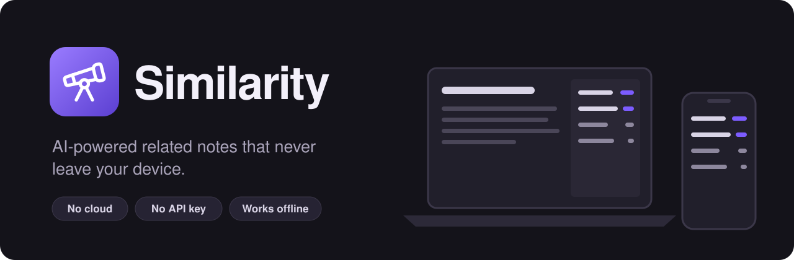
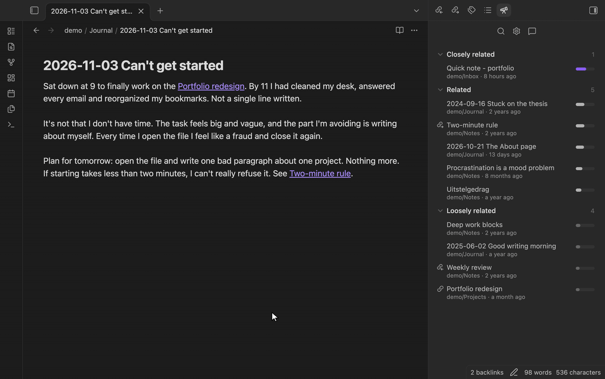
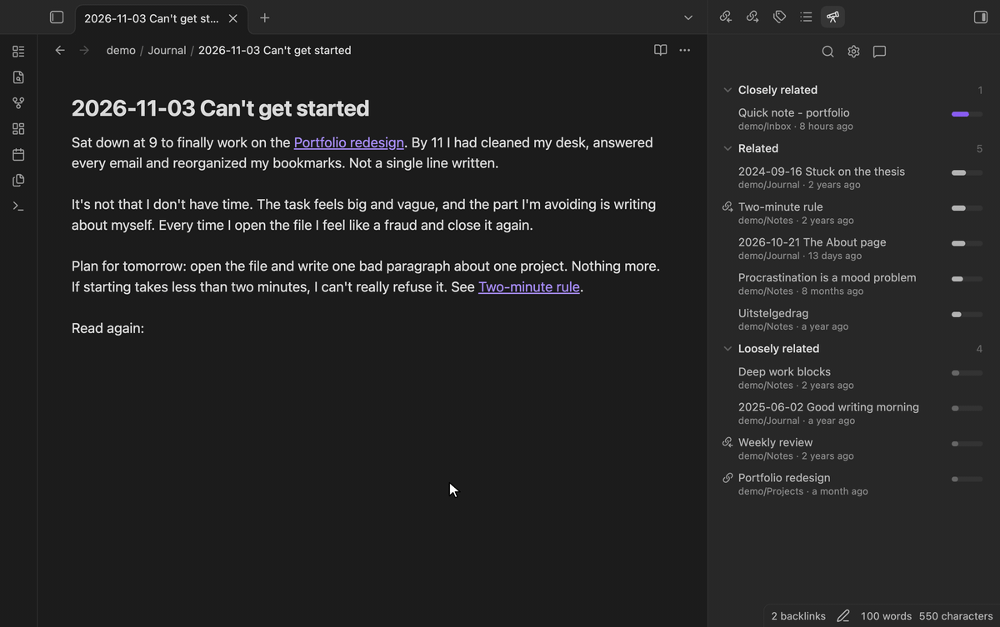
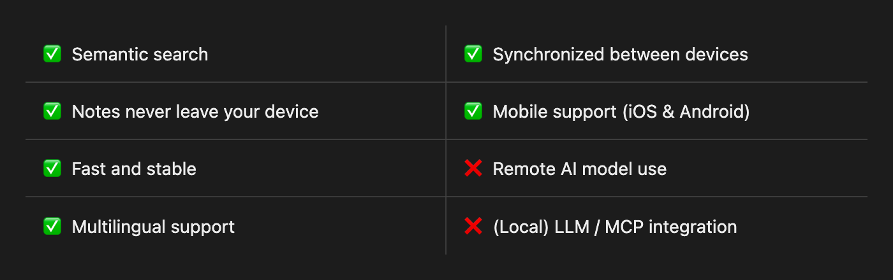

  

<strong>Semantic search and related notes for Obsidian. A tiny AI model that runs on your device.</strong>

  

  
  
  
  

  <a href="#how-it-helps-me">Why use it</a> ·
  <a href="#privacy">Privacy</a> ·
  <a href="#support">Support</a>

  

<em>Open a note and the sidebar shows what it's related to, linked or not.</em>

  

<em>Click 🔍 at the top of the sidebar to search in your own words, in any language. <kbd>⌘</kbd><kbd>⇧</kbd><kbd>↵</kbd> inserts the result as a link.</em>

## Features

## How it helps me
- Notes are never truly orphaned. If they don't have deep links, they still surface when I write something similar.
- I sometimes forgot that I already wrote about a topic, just using a different title. Now I can notes that talk about the same thing.
- When journaling, I see notes of times when I faced something similar. Looking back a few years to see how I dealt with the same topic has been insightful!
- It allows me to write with even less friction as I don't _need_ to do the chore of linking my note.

## Privacy

This plugin is built around one principle: your notes stay yours.

- All processing happens locally  
- No internet connection required after install  
- No tracking, no telemetry, no external services
- If you want, you can send bug reports and feedback through your own browser or mail client. You see the full content first.

## Similarity's Priorities

There are some other plugins in this space, each with their own strengths and approaches.

This plugin is built around the following set of priorities:

- **Fully local, by design**: your notes _never_ leave your device. I don't add features that violates that, even if it's opt-in.
- **Lightweight and fast**: fast and responsive software makes me happy :).
- **For everyone**: it's free forever and I make sure that Similarity works on every device.
- **Easy to use**: the plugin should help focus on writing, which is why the plugin is made to be as easy to understand and use as possible.
- **Feature Quality over Quantity**: it's tempting with agentic coding to add a billion features. But I try to not release any feature unless I think it's ironclad and genuinely useful.

## Support

Giving the repo a star helps ⭐️! It'll help visibility with the Obsidian team :).
